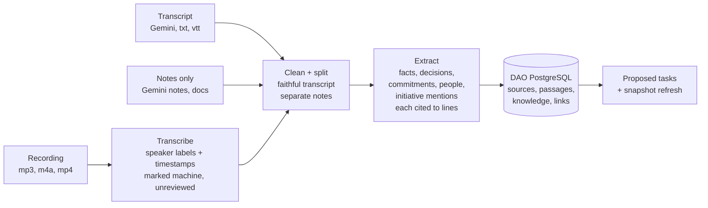
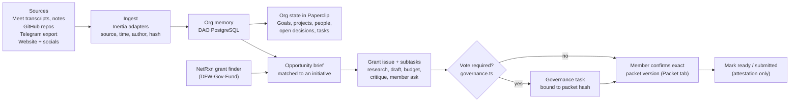

# FWTX DAO demo plan: from organizational context to a grant a member can act on

Drafted 2026-10-27 against `develop` `a8c707f`. Working plan, not a canonical artifact. It does not change spec, plan, decisions or the NTF checklist.

Dates: Roundtable rehearsal **Wednesday Oct 28**. HackFW submission closes **Friday Oct 30, 11:00am CDT**.

## 1. The short answer: where does "organizational management" actually happen?

It is **not the LLM alone**, and you do not need to invent a new process. There are three layers, and the demo should make each one visible:

| Layer | What it is | What it does in the demo | Trust |
|---|---|---|---|
| **LLM (agents)** | Codex/Claude runs inside Paperclip | Reads sources, extracts decisions and action items, writes briefs, drafts application sections, critiques drafts | Untrusted. Everything it produces is a *candidate* |
| **Inertia (the novel part)** | This repo: deterministic producers and adapters | Decides which candidates become real records and tasks, with source, hash, author, dedup key, parent goal, reason and acceptance criteria. Freezes exact packet versions. Checks whether a vote is needed | Deterministic code with rules and tests |
| **Paperclip (the org's system of record)** | Native goals, projects, issues, agents, assignments, checkout, approvals, budgets, audit | Holds the **current state of the organization**. This is what the member sees moving | Authoritative state |

The one-liner for the audience:

> **The LLM proposes. Inertia's rules decide what becomes real work, with a receipt back to the source. Paperclip tracks it. Members decide.**

That is what "organizational management" means here: every task on the board traces back to a meeting line, a repo issue, a chat message or a grant notice, and nothing becomes an approval or a submission without a verified member acting on an exact version.

Most of the process already exists in `develop`:

| Process step | Existing code | Status |
|---|---|---|
| Meeting → faithful transcript + notes → follow-up task | `src/roundtable/*` (extraction, ingestion, `native.ts`) | Merged, default-disabled, synthetic I/O qualified |
| Member/bounty objective → native issue | `src/intake` / objective composition (`docs/development/objective-intake.md`) | Merged, owner-file intake |
| Grant finder → preliminary brief → deadline/benefit facts | `src/discovery/*` (`preliminary.ts`, `funding-facts.ts`) + DFW-Gov-Fund | Merged, default-disabled |
| Saved knowledge query → research → writeback → reuse | `src/partners/research.ts`, SQL named tools | Merged, local PostgreSQL qualified |
| Draft + independent critique | `src/drafting/*`, `src/grants/native-review.ts` | Merged; zero real runs so far |
| Exact-version packet + member confirmation | `src/grants/member-*`, `src/ui/MemberPacketTab.tsx` (Packet tab) | Merged source; not live |
| "Does this need a vote?" + vote binding | `src/grants/governance.ts` | Merged, fixture verifier only |
| Buzz chat ↔ native comments | `src/bridge/*` | Merged |
| End-to-end synthetic walkthrough | `npm run demo:workflow` | **Runs today** (verified 2026-10-27) |

So the gap is not the process. The gaps are **(a) real FWTX data in, (b) a visible "state of the org" view, (c) actually running the agents once on a real grant, (d) a member logged in seeing it.**

For the plain-language "what is Inertia versus Paperclip, and why store notes" explainer, see [concept.md](concept.md).

## 0. Decisions so far (2026-10-27)

- **Runtime:** John's shared runtime (G1 uses it; local Docker is only the fallback).
- **Grant:** chosen closer to the demo from the grant finder.
- **Grant initiative:** *Pursue grant funding strategy* is a sample initiative, shown as **proposed, not yet voted**, with an open governance task. Grant projects still run under it for the demo, and the screen says so.
- **Vote threshold:** not needed for the demo.
- **On-screen member:** John.
- **Data:** real recordings and/or transcripts and notes will be supplied for testing.
- **Note:** the member app design from earlier needs reworking to show initiatives → projects → tasks and agent versus human work (section 1b). Not started.

## 1b. Org model: initiatives → projects → tasks

New direction (2026-10-27). This has to hold everywhere in the member app, not only in the grant demo.

| Level | Meaning | Who creates / changes it | Paperclip object (already exists) | Example |
|---|---|---|---|---|
| **Initiative** | A direction the DAO has adopted | Proposed by anyone or an agent; **adopted only through governance** | `Goal`, `level: "company"`. `planned` = proposed, `active` = adopted, `achieved` / `cancelled` | *Pursue grant funding strategy* |
| **Project** | A concrete effort that serves one initiative | Agents or members, inside an adopted initiative's mandate | `Project` with `goalId` = the initiative. Status `backlog → planned → in_progress → completed / cancelled` | *NSF CIVIC grant application* |
| **Task** | One unit of work, done by an agent **or** a member | Agents decompose; members can add | `Issue` with `projectId`, `goalId`, `parentId`, `acceptanceCriteria` | *Draft budget narrative*; *Pick the lead community story* |

The rules Inertia enforces (the deterministic part, not the LLM):

1. **An initiative becomes `active` only with a governance receipt.** That means a recorded decision or vote reference, through the same path as `src/grants/governance.ts`. An agent may draft a proposed initiative (`planned`) but can never activate one.
2. **A project needs an active initiative, or an explicit "pending governance" flag.** A project under a proposed initiative is allowed only when marked pending governance and shown that way; under a `cancelled` initiative it is refused. The demo uses the pending-governance path for the grant strategy. That is what makes "the grant is a project under the grant strategy" mean something: agents can open a new grant project without a fresh vote because the strategy is already adopted. A per-initiative rule can still require a vote for a single project, e.g. requests above $X or a funder requiring a DAO resolution.
3. **Every task has a project, a reason, acceptance criteria and a source link** (the existing follow-up rule, applied to everything).
4. **Each task has exactly one kind of owner:** an agent (`assigneeAgentId`) or a member (`assigneeUserId`). Paperclip already keeps these separate.

### Agent tasks versus human tasks

| Kind | How it is marked | What the assignee gets | Done when |
|---|---|---|---|
| **Agent task** | `assigneeAgentId`, label `agent` | Normal Paperclip agent run with checkout and budget | Agent run completes and meets acceptance criteria |
| **Human task (prepared ask)** | `assigneeUserId`, label `human` | The ask, why them, attached context (brief, draft section, critique), expected minutes, deadline, definition of done, choices: accept / decline | Member answers; an agent incorporates it. Accepted, declined and no response are recorded separately; silence is never a decline |
| **Agent work, human sign-off** | `assigneeAgentId` + an `executionPolicy` review stage whose participant is `type: "user"` | Agent does the work; the member sees an approval in their inbox | Member approves the exact version |
| **Governance task** | label `governance`, linked to the initiative or a packet hash | Members vote or record a decision through the DAO's actual process | Final result recorded; the initiative or packet is unlocked |

The labels are needed for **unassigned** tasks too: the CEO/triage agent decides "does this need a person?" when it decomposes a project. It applies `agent` or `human` before assignment so the human-ask queue is visible even before someone picks a task up. Typical human work: judgment, relationships, outreach, real-world events, choosing the story, confirming numbers, signing.

### What the member sees in the app

- **Initiatives:** adopted and proposed, each with its projects and its governance status.
- **Projects:** progress, with agent work and human work shown as separate counts (e.g. "7 agent tasks done, 2 waiting on members").
- **My asks:** human tasks assigned to me, plus approvals waiting on me, each with the context attached.
- **Open to members:** unassigned `human` tasks any verified member can claim.

Paperclip's inbox and issue lists already filter by assignee and label. The Packet tab covers the approval step for grant projects. The "Initiatives" and "Open to members" views are the new pieces.

### Grant example under this model

- **Initiative (adopted):** *Pursue grant funding strategy*. Seed it as `active` with its adoption evidence. If there is no real adoption record, show it as `planned` with a governance task, and say so.
- **Project:** *<Grant name> application*, opened when the grant finder's brief matches the initiative.
- **Agent tasks:** eligibility check, research gaps, draft narrative, draft budget, independent critique, incorporate member answers.
- **Human tasks:** pick the lead community story; confirm budget numbers; get a partner letter (outreach).
- **Sign-off:** a member confirms the exact packet version (Packet tab).
- **Governance task:** only if the per-initiative rule or the funder requires it.

## 1c. Ingesting recordings, transcripts and notes

None of this needs a live bot. Drop files in a folder (or a Drive folder later) and run one command.

| Stage | What happens | Exists? |
|---|---|---|
| 1. Intake | Accept a recording, transcript, notes or document. Store the raw original unchanged with SHA-256, meeting date, title and audience | Partly: `src/roundtable/source.ts` handles text sources and Drive metadata |
| 2. Transcribe (recordings only) | Speech-to-text with speaker labels and timestamps. Output is marked *machine transcript, unreviewed*. Recommendation: use Gemini's Meet transcript when the meeting was on Meet; otherwise Whisper (local `whisper.cpp` keeps audio private; a hosted API is faster). Speaker names mapped by a person, never guessed | **No, new** |
| 3. Clean and split | Faithful transcript kept separate from notes. Notes-only input produces notes plus a "no transcript" flag, never an invented transcript | Yes: `src/roundtable/ingestion.ts` |
| 4. Extract | Candidate facts, decisions, commitments and action items, each tied to exact lines and marked unverified. Add people and initiative/project mentions | Mostly: `src/roundtable/extraction.ts`, `knowledge.ts`; people/initiative links are new |
| 5. Store and index | Save sources, passages (with line ranges), knowledge items and links in DAO PostgreSQL. Add full-text search and `pgvector` embeddings so agents can retrieve them | **No, new**: the schema and search index |
| 6. Act | Propose follow-up tasks (existing follow-up rule) and refresh the affected initiative's snapshot | Follow-up exists in `src/roundtable/native.ts`; snapshot is new |

The same pipeline (stages 1, 4, 5, 6) takes the other sources. Telegram export, repo READMEs and issues, website pages and socials skip transcription and enter at "clean and split".

Re-running the same file is a no-op (same hash). A corrected transcript creates a new revision; it never silently overwrites.

## 2. The demo story (what the audience sees)

Run of show, about 8 minutes:

1. **"Here's FWTX DAO."** (1 min) Show the source folder: 3–5 meeting transcripts, the GitHub org, Telegram export, website, X/LinkedIn. One sentence: *Inertia ingested all of this.*
2. **"Here's what the org looks like now."** (2 min) Paperclip company *FWTX DAO*: goals, projects (from repos and dao-platform projects), agents (CEO/intake, researcher, drafter, critic), and an **Org Brief** document: active initiatives, who is working on what, open decisions, commitments made in meetings, each line with a source link. Click one citation → it opens the exact transcript line.
3. **"A task comes from that context."** (1 min) Show a follow-up issue created from a meeting action item: title, parent goal, reason, acceptance criteria, link to the transcript line. Point out the model suggested it; Inertia's rules (parent + reason + acceptance + dedup key) made it a task. Re-ingesting the same meeting creates **no duplicate**.
4. **"A grant comes in."** (2 min) Grant finder surfaces a new opportunity. Inertia matches it to an initiative already in org memory and posts a sourced brief: fit, deadline, award, eligibility unknowns. The CEO agent opens *Pursue: <grant>* with subtasks. Show the agent draft and the independent critique.
5. **"A member picks it up."** (2 min) Log in as a member (not admin). Their inbox has one prepared ask: *pick the lead community story, A or B, about 10 minutes*, with the brief and critique attached. They answer in Paperclip or Buzz. Draft v2 incorporates it. The Packet tab shows the exact version; the member confirms it. The governance check reports either "no vote required, single verified member approval" or "vote required, here is the task bound to packet hash …".
6. **Close.** (30 s) Show the receipt: elapsed time, human minutes, sources used, what is still pending. Honest gaps are a feature.

## 3. Gaps and how to fill them

Ranked by how much of the story breaks without them. "Fake it honestly" means pre-staged or fixture data, labelled as such on screen.

| # | Gap | Why it matters | Minimal fill for Wed/Fri | Effort |
|---|---|---|---|---|
| G1 | **Paperclip running with an FWTX company** | Nothing to show without it | Use John's shared runtime if up by Wed; otherwise local Docker preproduction (already passes). Create company *FWTX DAO*, 4 agents, 3–5 goals, 3–6 projects | 0.5 day |
| G2 | **Ingesting repos, Telegram, website, socials** | Only meetings, objectives and grants have adapters today | One **org-seed loader** script: reads a local `org-seed/` folder (transcripts `.md/.txt`, Telegram `result.json` export, website pages saved as Markdown, socials as CSV/JSON, GitHub READMEs/issues pulled via API) and writes knowledge records with `source, url, author, time, hash, audience`. No live bots; live Telegram is M2/later | 1 day |
| G3 | **"State of the org" view** | This is the "present it back" moment | Agent run produces an **Org Brief** native document from org memory, every claim cited. Plus native goals/projects seeded from it. Paperclip's own UI is the view, no new dashboard | 0.5 day + 1 agent run |
| G4 | **Meeting → task, live** | Proves tasks come from context | Enable the roundtable job manually on one real (or approved sanitized) transcript with the local source. Already built; needs config + one run | 0.5 day |
| G5 | **Grant finder → Inertia** | The external trigger | Run the DFW-Gov-Fund grant finder demo against one real current opportunity; feed its brief through the discovery path. If live wiring isn't ready, replay the grant finder's JSON output into the same adapter. Pick the opportunity **before** Wednesday | 0.5–1 day |
| G6 | **Actual agent runs** (zero so far) | The draft and critique must be system-generated, not hand-written | Run research → draft v1 → critique → draft v2 once end to end, the day before. Live demo shows the results plus one short live step (the member answer → v2) | 1 day incl. retries |
| G7 | **Member login and access** | "View as a member" is the main goal | One verified test member account in Paperclip with access to the grant project. For the demo, the trusted membership check can be a fixture allow-list clearly labelled as such, since NTF02 (real DAO ACL) is not wired | 0.5 day |
| G8 | **Packet tab live** | Member confirms exact version | Install the built plugin (`npm pack`) into the runtime; verify the Packet tab renders on the grant issue in a real browser | 0.5 day |
| G9 | **Governance branch** | Shows when the DAO vote matters | Use the fixture verifier and say so. Prepare one rule: e.g. requests above $X or funder-required DAO resolution → vote task. Do not run a real Vocdoni vote | 2 hours |
| G11 | **Initiative → project → task model** (section 1b) | Must be consistent across the member app | Seed initiatives as company goals with adoption state; create the grant as a project under *Pursue grant funding strategy*. Add the guards in Inertia: no `active` initiative without a governance receipt, and no project under an inactive initiative. Add `agent` / `human` / `governance` labels plus a triage step in the CEO agent's instructions | 1 day |
| G12 | **Member-facing views** | "View as a member" | Wednesday: native Paperclip inbox and label filters. After the demo: a plugin page with Initiatives, My asks and Open to members | 0.5 day (native) / 2+ days (plugin page) |
| G13 | **Recording → transcript** (section 1c stage 2) | Real recordings are coming | `whisper.cpp` (or a hosted API) wrapper producing timestamped, speaker-labelled text. Speakers mapped by hand | 0.5 day |
| G14 | **Org memory schema + search** (section 1c stage 5) | Without retrieval the agents don't really use the org context | DAO PostgreSQL tables for sources, passages, knowledge items and links; full-text search first, `pgvector` if time allows; a `context pack` function used by every agent task | 1–1.5 days |
| G15 | **Member app design rework** | Must show initiatives → projects → tasks and agent versus human work | Revisit the earlier design after the demo; for the demo, native Paperclip views (G12) | Post-demo |
| G10 | **Buzz** | Nice, not essential | Optional: show the same ask arriving in Buzz. Drop if time is short | — |

Critical path: **G1 → G11 → G13/G2 → G14 → G3 → G6**, with G5 and G7 in parallel. G2 (other sources) and G13 (transcription) both feed G14 (org memory). G9 and G10 are polish.

## 4. Data to collect (Kyle / team), today

Put these in a protected location, not in this public repo:

- [ ] 3–5 Wednesday meeting transcripts **with** Gemini notes, approved for demo use. At least one should contain a clear action item that relates to a fundable initiative
- [ ] List of FWTX GitHub repos to include (public `FWTX-DAO/*`: website, dao-platform, meeting-mode, governance, constitution, hackfw-judging-app)
- [ ] Telegram: desktop **Export chat history → JSON** for the main group, a recent window (e.g. 60 days), approved for demo
- [ ] Website URL and social handles (X, LinkedIn, Luma, etc.)
- [ ] The **target grant**: one real current opportunity from the grant finder, and a backup
- [ ] Which initiative it should match (so we can check the system finds it on its own)
- [ ] One member willing to be the on-screen member, plus their Paperclip login
- [ ] Any rule for when a grant needs a DAO vote (threshold or funder requirement)

## 5. Build order (proposed)

**Tue Oct 27 (today)**
- Confirm runtime target (shared vs local Docker) — G1
- Collect sources (section 4); pick the grant — G5
- Write the org-seed loader against a sample of each source type — G2

**Wed Oct 28 (Roundtable)**
- Seed FWTX company, goals, projects, agents — G1/G3
- Ingest sources; generate Org Brief — G2/G3
- Run meeting → task on one transcript — G4
- Use the live Roundtable itself as a source if recording is approved; otherwise rehearse with an earlier meeting

**Thu Oct 29**
- Grant finder → brief → grant issue → research → draft v1 → critique — G5/G6
- Member account, Packet tab, governance rule — G7/G8/G9
- Full dry run, record the backup video, fix what breaks

**Fri Oct 30, before 11:00am CDT**
- Final recording + receipt; submit

## 6. What we will and won't claim

Will claim: sources ingested with provenance; org state built from them; tasks traced to sources with no duplicates on replay; a system-generated brief, draft and critique for a real grant; a member confirming an exact version; governance checked against a rule.

Won't claim: live Telegram/social bots, a real DAO vote, external submission, production membership ACL, or untrusted member-owned agents. Show those as "next" on the last slide. The repo's existing honesty rules (spec, `Needed-from-team.md`) still apply: fixture values are labelled, unknowns stay unknown.

## 7. Open questions

Answered 2026-10-27: runtime (John's), grant (TBD later), on-screen member (John), vote threshold (not needed), grant strategy (proposed, not voted). See section 0.

Still open:
1. Is the Wednesday Roundtable itself being recorded for use as a live source?
2. What are the other current initiatives, so the Org Brief can place existing projects and repos under them?
3. Can members claim unassigned human tasks themselves, or only receive them by assignment?
4. Transcription: is local `whisper.cpp` acceptable (private, slower), or may recordings go to a hosted speech-to-text API?
5. Does John's runtime have access to the DAO PostgreSQL database with `pgvector` available, or does org memory start in a separate demo database?
