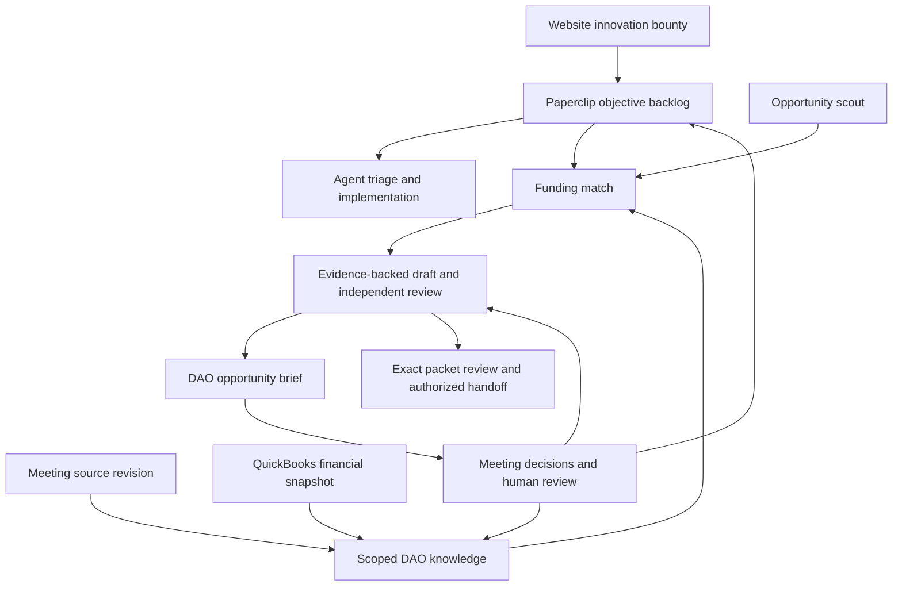

# Funding agents and DAO intake

Revision: FUNDING-2026-10-23-r1. Design for coordinated implementation in DFW-Gov-Fund and Inertia.

## Outcome

Agents turn public opportunities and DAO objectives into useful, evidence-backed drafts before asking members for help. Members see a short meeting brief, make the remaining decisions, and see those decisions reflected in subsequent work. Organizational knowledge is reused across opportunities; commitments retain their original scope.

## Decisions and implementation choices

**User decisions:** Paperclip owns the agent hierarchy, prioritization, tasks and human review; Buzz and its dashboard expose the same work. DFW-Gov-Fund owns the funding engine and portable harness. Support Codex, Claude and local agents. Use existing DAO PostgreSQL for funding and meeting domain data, with Paperclip's database separate. Meeting minutes supply reusable context; QuickBooks tracks finances. Every website innovation-bounty submission enters the general Paperclip backlog. Funding may support existing objectives. Prefer cloud execution, simple deployment and concise artifacts. Reassess CI value rather than preserving ceremony.

**Engineering choices:** use one canonical skill source with thin host packaging; one case owner plus independent review, with specialist work delegated when needed; server-enforced evidence scopes; per-item native human decisions; bounded research checkpoints; a structured opportunity brief rendered into native documents. Start with public evidence and supplied fixtures. Connect privileged data only during an authorized deployment step.

**Approaches:** native-first reuse is the selected direction. A separate funding dashboard duplicates task/review state and is retained only as an optional specialist view. A fixed six-agent team adds run overhead without fixing the observed evidence-to-answer gap; the six responsibilities below can run as separate tasks without six permanent agents. Add a custom grant editor only if native document editing and re-proposal prove inadequate in rehearsal.

## Baseline

DFW main `859a9f5a7b88bbbdd6eda3cb9c453fb15184a045`; Inertia develop `1ac44a7a5c9d8e1376e2c358ee2888b16be58905`, both rechecked 2026-10-23. Exact inspected paths and defects are in source-map.md.

July's five retained opportunity packets had 27 requirement rows with no supported answers and no named DAO programs in core narratives. The saved audit found 8 proposed-plan drafting opportunities, 6 partially answerable requirements, 10 genuine information gaps and 3 lead-only requirements. Those classifications are an audit hypothesis for evaluation, not a completion quota. The later Codex proposal service was not exercised by that historical run.

Existing services already provide acquisition, matching, evidence, draft packets, proposal persistence and human review operations. Extend these services. Existing Inertia provides signed Buzz transport, native interactions, meeting publication contracts and exact grant packet/vote binding.

## Workflow

### Six responsibility contracts

1. **Research:** collect current notice/requirements and relevant evidence; retain searches, coverage, failures and next sources.
2. **Eligibility:** determine direct, partner, next-cycle or monitor route from hard criteria; fit does not override eligibility.
3. **Evidence:** maintain attributed claims, source revisions, effective dates, access labels and reusable scope.
4. **Application:** write useful answers, clearly distinguish proposed work from established achievements, calculate budgets from supported inputs.
5. **Review:** independently check requirement coverage, claim support, calculations and contradictions against the frozen candidate and authorized evidence. Review cannot promote its own work into human approval.
6. **Submission preparation:** assemble the exact reviewed packet and required decisions. External submission remains an explicitly authorized human handoff.

A case owner routes work and owns completion. Research/review tasks use the same evidence snapshot; reviewers receive requirements and evidence before producer rationale. One first draft and up to two targeted rework rounds is the initial default; repeated unresolved findings become a specific escalation or deferred task, not another blind retry. Limits are configurable by the operator.

## Evidence and drafting requirements

- F01: Each answer carries exact requirement ID/version, text, evidence references and claim spans, answer kind (`factual`, `attributed`, `proposed`, `mixed`), unresolved gaps and route ownership. Citation membership alone is insufficient: reviewers assess whether the cited passage supports the claim.
- F02: Observed artifacts and attributed organizational statements may support draft narratives. They do not become verified legal, financial or past-performance facts. Proposed goals/work plans can be drafted without invented prior delivery or commitments.
- F03: Draft candidates remain useful before human signoff. Store and render machine-reviewed candidates separately from accepted applicant facts; do not require human acceptance of each sentence before constructing the packet. Existing accepted facts and human approval states retain their meaning.
- F04: Partner packets assign lead-only forms and certifications to the lead while drafting the DAO's capability and contribution sections. Required lead materials remain visible in whole-application readiness.
- F05: Missing information blocks only dependent answers and final readiness. Group human requests by decision or evidence owner, reuse already-current answers, and explain what each missing item prevents.
- F06: Budget actuals, proposed amounts and authorized commitments are distinct. Match/request arithmetic references exact operands and rules; an award ceiling is never the requested amount by default. Relevant evidence must support the particular amount/rate/commitment.
- F07: Research checkpoints distinguish complete coverage, bounded coverage, access blocked, source unavailable, exhausted budget and genuinely no eligible result. A zero-record page or max-pages cutoff cannot become exhaustive coverage. Respect existing source-admission controls.
- F08: Recheck source revisions, scope, deadlines, packet bytes and current domain grant-review authorization when applying a decision, inside the domain transaction that records its effect. Concurrent updates must yield a stale/conflict result.

## Reusable knowledge and financial sources

Store domain records in the DAO PostgreSQL deployment with separate migration ownership and scoped service roles. Reuse ApplicantProfile, ApplicantEvidence, ApplicantFieldValue and ApplicantDocumentVersion/Fact where their semantics match; add versioned knowledge/decision provenance rather than a competing organization profile.

A reusable record contains `organization_id`, `record_id`, `revision`, `kind`, `scope_kind`, `scope_id`, `value`, `source_id`, `source_revision`, `source_locator`, `source_hash`, `observed_at`, `effective_from`, `effective_until`, `status`, `audience`, `supersedes_id`. Kinds: fact, priority, resource, decision, commitment. Scope: organization, project, opportunity. Status: candidate, current, disputed, superseded, revoked. Missing effective dates stay unknown. Only compatible scope and current, authorized records enter a workspace. Conflicts remain visible; latest text alone does not win.

Meeting extraction proposes these records with quoted evidence. Discussion and motions stay separate from adopted decisions. Proposals always enter candidate status. Trusted source admission can establish attributable factual observations; a trusted adopted-decision record or configured authorized human confirmation establishes adoption and scope for decisions and commitments. Only trusted transitions can widen scope or change status to current. Routine factual observations need no DAO vote. Corrected minutes invalidate dependent candidate drafts and create targeted refresh work.

QuickBooks supplies read-only financial snapshots with company, report/transaction reference, period, accounting basis, currency, retrieval time and content hash. Financial actuals are not available grant budget or spending approval. An authorized, sanitized export can support the initial adapter fixture; live OAuth/configuration is a later deployment action. Never embed account credentials or broad finance records in member workspaces.

## General intake and funding alignment

Every innovation-bounty submission produces one linked Paperclip backlog item, preserving submitter identity, source revision, visibility and original text. Updates modify the linked item; retries do not duplicate it. Similar submissions remain separately attributable while linked to a shared objective. The CEO's assigned intake mandate owns prioritization and decomposition. Agent execution follows configured authority and budgets.

One objective can relate to multiple funding opportunities, and one opportunity can support multiple objectives. Each link records fit rationale, requirements, proposed contribution and the associated packet. Funding status does not replace project status. Withdrawal/correction updates the originating website record and corresponding work without deleting audit history. Source text is data, not tool authorization.

## DAO presentation and meeting loop

The canonical brief is structured data rendered into a native Paperclip document and permission-appropriate website/Buzz views. Show: opportunity and deadline; amount/range and source; direct/partner route; fit; related active projects; proposed outcome; application effort; delivery effort; reporting/maintenance obligations; evidence-backed draft progress; remaining decisions; information owners; recommendation and next action. Estimates include basis and ranges. Do not use a single vague LOE number.

Meeting outcomes may pursue, revise, defer or decline. Record the decision scope and source, assign follow-up diligence/research/drafting/review, refresh the packet, and reuse new facts for later opportunities. A generic task completion, agent review, native human signoff and Vocdoni vote are separate records.

## Portable delivery and native Paperclip

Canonical skill source remains `.agents/skills/dfw-funding-orchestrator`; generate or validate copies for packaging. Add neutral tool aliases while preserving `codex_drafting_workspace`, `save_codex_proposals`, persisted IDs and backward compatibility. Skill instructions define responsibilities/output schemas, not a vendor-specific agent loop. An OpenAI-compatible model endpoint still needs a tool-using runtime.

Use Agent Skills SKILL.md and portable Agent Plugins metadata; provide Claude's native `.claude-plugin/plugin.json` wrapper. Validate `mcpServers` packaging against each host and resolve the existing MIT/Proprietary metadata conflict before distributing. Runtime dependencies install where execution occurs, independently of skill import.

Paperclip's managed company skill library and per-agent assignment own skill delivery. Qualify Codex and Claude managed adapters; qualify one explicitly named local runtime. Generic process/HTTP skill assignment is not enough to establish execution. Evaluate the native governed Custom MCP/Tool Gateway path against the deployed release and configuration; direct MCP is a distinct permission route. Inertia's server plugin remains trusted integration code, not a container for member agents.

## Security and authority

Server scope is derived from authenticated company, applicant, task and principal. Members receive only allowed evidence plus proposal tools in isolated workspaces. They receive no organization DB, financial/portal credentials, human signoff tools or privileged publisher token. Enforce read restrictions before retrieval and output restrictions before publication.

Native human-only cards are necessary but insufficient: trusted code verifies an actual human actor, designated role and exact target. Correlate effects with interaction ID + item ID + target identity/revision/hash + action. Store a unique domain effect receipt in the same transaction as the mutation. Reconcile cross-system acknowledgment loss; do not claim a distributed transaction. Domain grant-review capabilities and their epochs are transactionally checked with the effect; native actor/membership is freshly verified with a configured maximum age and fail-closed behavior. Native revocation is not a cross-system transaction: immediate denial uses domain-capability revocation, and native revocation events invalidate pending work. Partial cards apply resolved items only. Defer has no acceptance effect. Rejection and changes-requested mappings retain domain semantics.

## Success and deployment gates

Public-only fixtures must show useful, cited answers for answerable requirements, explicit proposals where appropriate, no fabricated facts, no premature human requests for agent-researchable gaps and no route/authority regression. Compare Codex, Claude and one local runtime on the same frozen inputs. Evaluate human correction burden, material-error rate, supported coverage, research coverage, cost and elapsed time, not agent count or raw word count.

Historical July replay requires exact retained artifacts; it is not a dependency for current public-only work. Current enrichment and historical replay have separate reports. Real integration admission requires authorized source access, website server contract, actual reviewer mapping, scoped runtime/tool configuration and database migration qualification. CI/dependency baseline restoration is separately owned; skipped tests are not passed tests. Existing voting/member/Y2 roadmap remains active.
