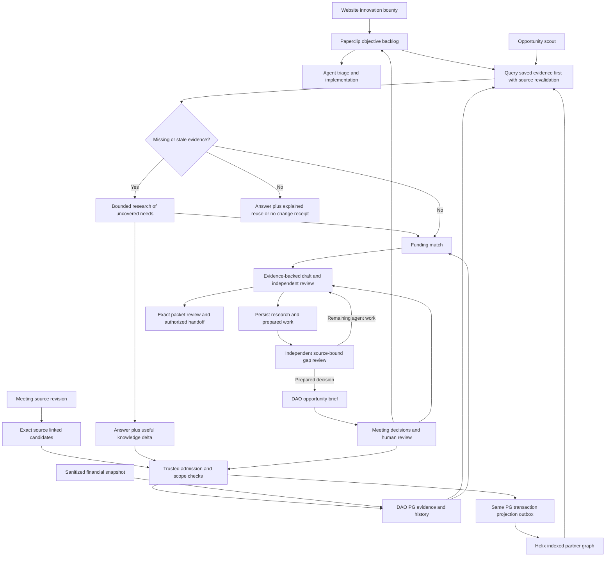

# Funding agents and DAO intake

Revision: FUNDING-2026-10-23-r4. Implementation status and remaining contracts for DFW-Gov-Fund and Inertia.
Updated: 2026-10-24 (UTC)

## Outcome

Agents turn public opportunities and DAO objectives into useful, evidence-backed drafts before asking members for help. Members see a short meeting brief, make the remaining decisions, and see those decisions reflected in subsequent work. A maintained Helix partner/people graph makes existing knowledge easy to query, and each research run adds useful evidence for future work. Commitments retain their original scope.

## Decisions and implementation choices

**User decisions:** Paperclip owns the agent hierarchy, prioritization, tasks and human review; Buzz and its dashboard expose the same work. DFW-Gov-Fund owns the funding engine and portable harness. Support Codex, Claude and local agents. Use existing DAO PostgreSQL for funding and meeting domain data, with Paperclip's database separate. Meeting minutes supply reusable context; QuickBooks tracks finances. The maintained partner graph and query-first research writeback are core; broader 990 enrichment and optional vector/semantic search come later. Every website innovation-bounty submission enters the general Paperclip backlog. Funding may support existing objectives. Prefer cloud execution, simple deployment and concise artifacts. Keep CI focused on useful checks.

**Engineering choices:** use one canonical skill source with thin host packaging; one case owner plus independent review, with specialist work delegated when needed; server-enforced evidence scopes; per-item native human decisions; bounded research checkpoints; a structured opportunity brief rendered into native documents. Start with public evidence and supplied fixtures. Connect privileged data only during an authorized deployment step.

**Approaches:** native-first reuse is the selected direction. A separate funding dashboard duplicates task/review state and is retained only as an optional specialist view. A fixed six-agent team adds run overhead without fixing the observed evidence-to-answer gap; the six responsibilities below can run as separate tasks without six permanent agents. Add a custom grant editor only if native document editing and re-proposal prove inadequate in rehearsal.

## Baseline

DFW main `16e96b22d55caaa0c19513e121028ab78c3aa1c7` (PR46) and Inertia develop `6f93cfef486b017afccda7b275837e09213aa189` (PR28) include merged public drafting/gaps, Task 6, partner graph, cloud qualification/race fixes and objective intake/briefs. Independent real-PG/native/Helix cloud rehearsal and the synthetic actual-service meeting-answer loop passed. Inertia native review is merged/default-disabled; DFW service is reviewed/in CI; the approved durable exact-version acceptance model awaits host-seam implementation and qualification. Exact receipts and activation gates are in [source-map.md](source-map.md).

July's five retained opportunity packets had 27 requirement rows with no supported answers and no named DAO programs in core narratives. The saved audit found 8 proposed-plan drafting opportunities, 6 partially answerable requirements, 10 genuine information gaps and 3 lead-only requirements. Evaluate those classifications as audit hypotheses. That historical run predates evaluation of the Codex proposal service.

Existing services already provide acquisition, matching, evidence, draft packets, proposal persistence and human review operations. Extend these services. Existing Inertia provides signed Buzz transport, native interactions, meeting publication contracts and exact grant packet/vote binding.

## Workflow

The approved [operational discovery loop](discovery-loop.md) extends this workflow through Tasks 5, 6C/6D and 8. It combines due-source rechecks and bounded new-source search with official validation, benefit-versus-effort assessment, durable writeback, prioritized briefs, deduplicated urgent alerts and native follow-ups. Host wiring remains planned and the daily profile schedule remains disabled.

### Six responsibility contracts

1. **Research:** query saved partners/evidence first, then collect only missing or stale notice/requirement and capability facts. Retain searches, coverage, failures and next sources; finish with an answer plus durable useful knowledge delta, even for a rejected opportunity.
2. **Eligibility:** determine direct, partner, next-cycle or monitor route from hard criteria; hard eligibility criteria govern each route.
3. **Evidence:** maintain attributed claims, source revisions, effective dates, access labels and reusable scope.
4. **Application:** write useful answers, clearly distinguish proposed work from established achievements, calculate budgets from supported inputs.
5. **Review:** independently check requirement coverage, claim support, calculations and contradictions against the frozen candidate and authorized evidence. Review cannot promote its own work into human approval.
6. **Submission preparation:** assemble the exact reviewed packet and required decisions. External submission remains an explicitly authorized human handoff.

Paperclip owns tasks, hiring, scheduling and review UI; Buzz exposes the same work. A case owner routes work and owns completion. Research/review tasks use the same evidence snapshot; reviewers receive requirements and evidence before producer rationale. One first draft and up to two targeted rework rounds is the initial default; repeated unresolved findings produce a specific escalation or deferred task. Limits are configurable by the operator.

## Evidence and drafting requirements

- F01: Each answer carries exact requirement ID/version, text, evidence references and claim spans, answer kind (`factual`, `attributed`, `proposed`, `mixed`), unresolved gaps and route ownership. Citation membership alone is insufficient: reviewers assess whether the cited passage supports the claim.
- F02: Observed artifacts and attributed organizational statements may support draft narratives. Legal, financial and past-performance facts require separate claim-specific verification. Proposed goals/work plans can be drafted without invented prior delivery or commitments.
- F03: Draft candidates remain useful before human signoff. Store and render machine-reviewed candidates separately from accepted applicant facts; assemble the candidate packet before requesting human signoff. Existing accepted facts and human approval states retain their meaning.
- F04: Partner packets assign lead-only forms and certifications to the lead while drafting the DAO's capability and contribution sections. Required lead materials remain visible in whole-application readiness.
- F05: Missing information blocks only dependent answers and final readiness. Group human requests by decision or evidence owner, reuse already-current answers, and explain what each missing item prevents.
- F06: Budget actuals, proposed amounts and authorized commitments are distinct. Match/request arithmetic references exact operands and rules; an award ceiling is never the requested amount by default. Relevant evidence must support the particular amount/rate/commitment.
- F07: Research checkpoints distinguish complete coverage, bounded coverage, access blocked, source unavailable, exhausted budget and genuinely no eligible result. A zero-record page or max-pages cutoff cannot become exhaustive coverage. Respect existing source-admission controls.
- F08: Recheck source revisions, scope, deadlines, packet bytes and current domain grant-review authorization when applying a decision, inside the domain transaction that records its effect. Concurrent updates must yield a stale/conflict result.

## Actionable gaps and public drafting

The merged bridge exposes only `funding_drafting_workspace`, `save_funding_proposals` and `save_funding_gap_progress` through `create_public_funding_mcp`. The host supplies authenticated company/applicant/task identities, current public evidence and reviewer/repair adapters. Operator MCP remains privileged and separate. Drafts stay unaccepted through independent review and at most two targeted repairs.

For partnership gaps, query the saved partner graph and authoritative evidence for existing DAO affiliations, capabilities, relationship owners and prior programs before investigating missing or stale facts about relevant local partners. Save source-backed relationship paths, proposed roles, exact public-contact passages, evidence needs and prepared work. Prefer completing a worksheet, cited answer, role matrix, unsigned letter outline or cost scenario to returning a generic missing-information label. Preparation never authorizes outreach or commitments.

`GapProgress` persists ordered research attempts and preparation in existing `WorkbenchAuditEvent` records. `previous_hash` protects competing successors; replay deduplicates and prior attempts remain in history. Current source/workspace bindings control packet projection. Regenerated Markdown and DOCX retain the prepared work, options and next actions. Source changes invalidate old projections without discarding research history.

`GapPlanReview` binds the exact requirement, workspace and progress hashes. A trusted reviewer handles `kind="gap_plan"` with independent authenticated identity. A human handoff requires sufficient preparation, evidence supporting the action, a precise authority/access/private-record decision and no useful agent work remaining. Rejected plans return the next agent step. Missing host support leaves work agent-owned at `review_prepared_handoff`.

The default checkpoint threshold is six attempts per current workspace, triggering coverage review. Handoff and termination require their respective criteria. Host research budgets remain configurable. Benchmark v3 evaluates the prepared handoff; earlier v2 judgments require reassessment.

## Reusable knowledge and financial sources

Task 6 (`dao-knowledge-v1`) supplies the merged evidence/SQL foundation; real disposable PostgreSQL qualification passed. Production source/importer and role activation remain pending. `OrganizationKnowledge` reuses ApplicantProfile and ApplicantDocumentVersion/Fact with WorkbenchAuditEvent history. Its DFW Alembic-owned schema and scoped roles remain in the DAO PostgreSQL deployment. Existing website/member/project objects retain their owner and canonical IDs.

A reusable record contains `organization_id`, `record_id`, `revision`, `kind`, `scope_kind`, `scope_id`, `value`, `source_id`, `source_revision`, `source_locator`, `source_hash`, `observed_at`, `effective_from`, `effective_until`, `status`, `audience`, `supersedes_id`. Kinds: fact, priority, resource, decision, commitment. Scope: organization, project, opportunity. Status: candidate, current, disputed, superseded, revoked. Missing effective dates stay unknown. Only compatible scope and current, authorized records enter a workspace. Keep conflicts visible and resolve them through trusted source admission.

Meeting extraction proposes these records with quoted evidence. Discussion and motions stay separate from adopted decisions. Proposals always enter candidate status. Trusted source admission can establish attributable factual observations; a trusted adopted-decision record or configured authorized human confirmation establishes adoption and scope for decisions and commitments. Only trusted transitions can widen scope or change status to current. Routine factual observations need no DAO vote. Corrected minutes invalidate dependent candidate drafts and create targeted refresh work.

Task 6 normalizes one documented sanitized USD Profit & Loss fixture, preserving exact Decimal amounts, company/reference, period, cash/accrual basis, currency, retrieval time and content hash. Actual QuickBooks report/API compatibility requires qualification of the selected export and production adapter. Available grant budget, available cash and spending authority require their own evidence. Keep broad finance records and credentials outside member workspaces.

## Core maintained partner graph

The first graph answers partner-by-capability, permitted contacts/roles, actual contribution history, evidenced warm-introduction paths through DAO relationship owners, and potential lead/delivery/fiscal roles with remaining opportunity-specific checks. Reuse existing Task 6 evidence and source IDs; Paperclip retains task ownership.

### Coverage and identity

Index every relevant organization, work contact and affiliation, program/project/event, contribution and relationship owner from the bounded authorized inventory of existing records, website sources and meetings. Coverage receipts bind source ID/revision, processed item, canonical entity or explicit unresolved disposition. Start with DAO, TechFW/MADE, Moonshot, LiquidAcre and HackFW, then cover the inventory rather than stopping at the seeds.

Use existing member/project IDs or stable opaque PG identities. Source-system bindings, exact identifiers and reviewed aliases establish identity; a matching name/domain is only a candidate. Merge/split is audited, reversible and triggers reprojection. MADE is a TechFW program. Moonshot and LiquidAcre are existing collaborators, while particular people, introductions and delivery roles require their own evidence. Preserve “Liquid Acres” as a candidate spoken alias until admitted. Employee, coach, event-host and DAO relationship-owner roles each carry their own evidence. Unknown owners remain unassigned.

DAO EIN 41-2815082 and IRS public-charity status are verified from official records. The determination-letter attachment remains uncollected. Filing address, Fort Worth service geography, exact legal identity and each opportunity's eligibility remain separate evidence. Source links and limits are in [source-map.md](source-map.md#partner-and-irs-seed-evidence).

### Typed evidence and lifecycle

Add a separately versioned assertion envelope to Task 6: canonical subject, predicate, object or typed value, qualifiers and semantic assertion key. Entity types cover organizations, people, programs, projects, events, opportunities and capabilities. Relations include PROGRAM_OF, AFFILIATED_WITH with role, HAS_CAPABILITY, PARTICIPATED_IN with role/stage, WORKED_WITH with activity, RELATIONSHIP_OWNER, CONTACT_FOR, evidenced INTRODUCED_TO and RELEVANT_TO_OPPORTUNITY.

Bind trusted admission to the full envelope version/identity/value/qualifiers, exact source revision/hash, audience and project/opportunity scope. Reusing an admitted quote cannot authorize a changed triple. Preserve locator/quote, knowledge revision, observed/checked time, known effective intervals and admission history. `organization_id` denotes the owning applicant access boundary; the typed assertion identifies the subject partner. `as_of` selects current available assertions valid at that time; separately authorized history reads reconstruct changes.

Keep evidence lifecycle, relationship category and activity delivery stage independent. Prospects stay separate from collaborators; planned/started/completed/cancelled/unknown stages require activity-specific evidence. Completion requires dated delivery evidence. Officially described capability, proposed contribution and demonstrated delivery also remain distinct. October 30 closing-host work remains planned.

Use canonical semantic values and a scoped subject/predicate/qualifier conflict key with predicate cardinality and overlapping-validity rules. Equivalent typed claims corroborate; contradictory single-valued claims dispute; multiple capabilities/affiliations coexist. Each corroborating source keeps its own audience, validity and revocation. Preserve legacy dao-knowledge-v1 exact-quote behavior.

### Query first and durable writeback

Every scan/diligence task queries saved evidence before external discovery and researches only missing or stale facts. Return both the answer and a knowledge-delta receipt. Retain discoveries that update a known entity, answer a reusable capability/contact/route question, document shared work or close an evidence gap. Rejected opportunities can contribute such evidence; unrelated scrape content is excluded. An explained zero-delta receipt completes the task without a graph write.

A trusted commit endpoint authenticates tenant/principal/scope and takes run ID, idempotency key, expected revisions, source bindings and candidate assertions. In one DAO PG transaction it admits permitted evidence/typed assertions, records existing audit history and appends projection outbox rows. Tenant + run + delta key with payload hash returns the same receipt for replay and rejects changed payloads. Source/revision/hash/locator + semantic assertion + scope deduplicates evidence without discarding independent corroboration. PG uniqueness/CAS handles concurrent updates.

The receipt identifies committed/reused/disputed/candidate IDs/revisions, ignored-item reasons, source bindings and projection sequence/state. A durable PG result may return while graph refresh is pending, but projection work remains open until reconciled. Completion requires durable retention of useful knowledge with its original organization/project/opportunity scope.

### Indexed retrieval and recovery

Helix holds derived nodes/edges keyed by canonical identity/assertion; PG holds authoritative facts. Scope-tag names, aliases and contact attributes separately; hydrate exact evidence from PG only after access checks. Expose bounded `query_partners`, `get_partner_context`, `find_introduction_path` (at most three hops) and `commit_research_delta` tools, plus operator-only projection health. Derive authority server-side, filter every hop, revalidate PG/source revision/access/freshness, and return evidence gaps or partial coverage explicitly.

An atomic PG outbox drives idempotent projection. Lease takeover advances a target-side fencing epoch; each Helix write batch must atomically check epoch and authoritative revision, apply changes/removals and store its receipt. Qualify that behavior against the actual pinned API. Reconcile lost responses before retry, confirm durable application before PG acknowledgment and prevent old upserts from reviving tombstones. A lease alone is insufficient.

Backfill has durable item dispositions and keyset checkpoints; incremental refresh uses actual source revisions/cursors. Record read failures separately and require authoritative deletion evidence for removals. Rebuild a fresh generation from a PG snapshot and gap-safe committed high-water mark, replay subsequent deltas, compare IDs/revisions/counts/hashes, then switch. Corrections/revocation deny authoritative retrieval immediately and queue priority removals, including aliases, contacts and any future vectors/caches.

If Helix is unavailable or behind, use bounded indexed PG queries and mark degraded coverage; if PG/source authorization is unavailable, withhold affected results. Reuse saved evidence through the fallback. Qualify active indexes, actual transactional guards and real PG/Helix recovery before release. Initial unmeasured targets: 10,000 entities/100,000 assertions, top-20 queries with revalidation p95 <1 second, update visibility p95 <60 seconds. Broader 990 enrichment and semantic/vector search are later, with identical scope/removal rules.

## General intake and funding alignment

Every innovation-bounty submission produces one linked Paperclip backlog item, preserving submitter identity, source revision, visibility and original text. Updates modify the linked item; retries do not duplicate it. Similar submissions remain separately attributable while linked to a shared objective. The CEO's assigned intake mandate owns prioritization and decomposition. Agent execution follows configured authority and budgets.

One objective can relate to multiple funding opportunities, and one opportunity can support multiple objectives. Each link records fit rationale, requirements, proposed contribution and the associated packet. Funding and project status retain their respective domain owners. Withdrawal/correction updates the originating website record and corresponding work without deleting audit history. Treat source text as data; trusted policy authorizes tool actions.

## DAO presentation and meeting loop

The canonical brief is structured data rendered into a native Paperclip document and permission-appropriate website/Buzz views. Show: opportunity and deadline; amount/range and source; direct/partner route; fit; related active projects; proposed outcome; application effort; delivery effort; reporting/maintenance obligations; evidence-backed draft progress; remaining decisions; information owners; recommendation and next action. Estimates include basis and ranges. Estimate application, delivery and reporting effort separately.

Meeting outcomes may pursue, revise, defer or decline. Record the decision scope and source, assign follow-up diligence/research/drafting/review, refresh the packet, and reuse new facts for later opportunities. A generic task completion, agent review, native human signoff and Vocdoni vote are separate records.

## Portable delivery and native Paperclip

Canonical skill source remains `.agents/skills/dfw-funding-orchestrator`; generate or validate copies for packaging. Add neutral tool aliases while preserving `codex_drafting_workspace`, `save_codex_proposals`, persisted IDs and backward compatibility. Skill instructions define portable responsibilities and output schemas. An OpenAI-compatible model endpoint still needs a tool-using runtime.

Portable skills 3.4.1 supplies canonical Agent Skills content, Agent Plugins metadata and the native Claude wrapper. Packaging uses `mcpServers`, preserves MIT licensing and defaults to skills-only installation without starting privileged MCP. Codex offline installation/cache refresh is verified. Next, qualify model-driven Codex/Claude/local execution and Paperclip skill/tool authorization. Runtime dependencies install where execution occurs, independently of skill import.

Paperclip's managed company skill library and per-agent assignment own skill delivery. Qualify Codex and Claude managed adapters; qualify one explicitly named local runtime. Verify actual tool-using execution for process/HTTP runtimes. Evaluate the native governed Custom MCP/Tool Gateway path against the deployed release and configuration; direct MCP is a distinct permission route. Inertia's server plugin provides trusted integration code; isolated runtimes execute member agents.

## Security and authority

The frozen native-review adapter remains default-disabled: native session loss can release source locks before a separate funding transaction commits. The approved successor records durable authority for an exact command/version at native acceptance, surviving disconnect. Funding-service confirmation establishes cancellation; changed funding evidence blocks stale execution; grant submission remains separate. Implement and qualify the acceptance/reconciliation seam and production writer-fence composition before activation.

Server scope is derived from authenticated company, applicant, task and principal. Members receive only allowed evidence plus proposal tools in isolated workspaces. They receive no organization DB, financial/portal credentials, human signoff tools or privileged publisher token. Enforce read restrictions before retrieval and output restrictions before publication.

Frozen adapter contract: native human-only cards are necessary but insufficient: trusted code verifies an actual human actor, designated role and exact target. Correlate effects with interaction ID + item ID + target identity/revision/hash + action. Store a unique domain effect receipt in the same transaction as the mutation. Reconcile cross-system acknowledgment loss through durable effect receipts. Domain grant-review capabilities and their epochs are transactionally checked with the effect; native actor/membership is freshly verified with a configured maximum age and fail-closed behavior. Immediate denial uses domain-capability revocation. Native revocation events propagate across stores and invalidate pending work. Partial cards apply resolved items only. Defer has no acceptance effect. Rejection and changes-requested mappings retain domain semantics.

## Success and deployment gates

Public-only fixtures must show useful, cited answers for answerable requirements, explicit proposals where appropriate, no fabricated facts, no premature human requests for agent-researchable gaps and no route/authority regression. Compare Codex, Claude and one local runtime on the same frozen inputs. Evaluate human correction burden, material-error rate, supported coverage, research coverage, cost and elapsed time.

Historical July replay requires exact retained artifacts. Fresh October discovery, current public enrichment and historical replay have separate reports. October discovery is complete and merged; its exact confidence overlay is preserved and the [priority diligence queue](https://github.com/NetRxn/DFW-Gov-Fund/blob/main/government-funding-dfw/docs/discovery/2026-10-23-priority-diligence.md) guides next preparation. The historical DNS-failed attempt, manual findings and dated replay retain their separate labels. The graph core is merged and has passed independent real-PG-to-embedded-Helix cloud rehearsal; live acceptance still requires a complete authorized query → research → durable delta → next-run reuse workflow. Real integration admission requires authorized source access, website server contract, actual reviewer mapping, scoped runtime/tool configuration and database migration qualification. CI/dependency qualification is separately owned. Record passed, failed and skipped tests distinctly. Existing voting/member/Y2 roadmap remains active.
