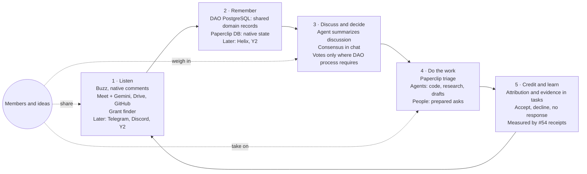

# Proposal: member-centered loop

Proposed 2026-10-24 against `develop` `a1fa90d` (PR53); revised the same day after the [maintainer's answers](https://github.com/NetRxn/Inertia/pull/59#issuecomment-6388561995), checked against `develop` `3560f1e` (PR58). Status: **proposal for discussion**. This file is not a canonical artifact and changes no existing contract, decision or sprint priority. The canonical-artifact owner decides what, if anything, is adopted into spec, plan, decisions, testing and the deck.

## Summary

Inertia already connects DAO conversations, meetings, grant packets and member agents, with Paperclip as the operational platform (D10) and Buzz and the dashboard as alternative interfaces (D11). This proposal adds a member-facing layer on top of that foundation:

- **Members and their ideas are the focus.** Agents do the backend work (code, research, drafting, summaries). Work that needs a person (creative input, judgment, relationships, outreach, events, real-world tasks) is routed to a member as a prepared, specific ask.
- **Anyone can take part.** For Wednesday, members use native Paperclip and Buzz. Other chat channels and a separate web view can follow.
- **Deliberation is real work.** Much DAO work (pursuing grants, outreach, partnerships) needs member discussion before anyone acts. Agents summarize discussions and turn rough consensus into clear proposals.
- **The agent stays inside boundaries the DAO sets**, using the DAO's actual governance process where it is required.

Nothing here asks to change the October 30 demo scope. The grant storyline below fits the existing three outcomes (D01).

## Wednesday priorities (from the maintainer's answers)

Operational target: **Wednesday, October 28**. Submission: Friday, October 30 at 11 a.m. CDT.

- **Rehearsal:** one sourced brief → a prepared member ask → the response incorporated into a funding case.
- **Now:** M4 discussion synthesis, a thin M5 human-ask flow, and M6-lite (contribution attribution and evidence inside existing tasks). M1 contributes the identity-mapping contract. M3 adds only the records this workflow needs. M7 uses native Paperclip/Buzz.
- **Later:** Telegram/Discord (M2), automated profile matching, credit scoring, a separate status web view and a governance-charter project (M8).
- **Measurement:** the [#54](https://github.com/NetRxn/Inertia/issues/54) receipt contract ([PR60](https://github.com/NetRxn/Inertia/pull/60)).

## The loop

1. **Listen.** Buzz and native comments, Wednesday Meet recordings and Gemini notes, Drive documents, the GitHub repo and the grant finder enter through one adapter boundary and become one record shape with source, time and author. Telegram, Discord and Y2 are later options.
2. **Remember.** Shared domain records live in DAO PostgreSQL under the existing [storage contract](../development/dao-data-consolidation.md). Paperclip's own database holds native operational state. Plugin storage does not become a competing source of truth. Helix and Y2 are deferred for this demo and shown as later options.
3. **Discuss and decide.** Agents post short briefs, summarize discussion, surface agreement and open questions, and draft proposals. Ordinary packet approval is one currently verified member with current application-action access. The DAO's formal governance process, including votes, applies only where it is actually required.
4. **Do the work.** Paperclip breaks work into tasks and asks of each: does this need a person? Agent work stays with agents. Human asks go to a member with the research and drafting already attached.
5. **Credit and learn.** Contributions are attributed with evidence inside existing tasks, including non-code work. Responses to asks are recorded as accepted, declined or no response; silence is never counted as a decline. Results feed back into Listen.

## What this builds on

| Existing work | Role in the loop |
|---|---|
| Signed Buzz bridge, confirmation cards, comment mirroring | Wednesday channel; template for later chat adapters |
| Roundtable meeting source/native composition (PR34) | Meeting input for Listen |
| DAO PostgreSQL storage contract and SQL named-tool facade | Remember; Helix projection is deferred |
| Discovery foundation and source-bound funding facts (PR35/36) | Grant finder as the first external plugin |
| Collaborative member packet v2 and native exact-action capture (PR56/PR58) | Decide: one verified member approves an exact packet version; Mark submitted is version-bound attestation |
| Grant packet binding and Vocdoni verifier path (PR7, U06, NTF08) | Decide, only where a vote is actually required |
| Member candidate boundary (PR37), member ingress (#41) | Basis for member identity and contribution receipts |
| Paperclip tasks, checkout, approvals, budgets (D10, D12) | Do the work; enforcement for the governance layers below |
| Demo-evidence receipts (#54, PR60) | Measurement for Credit and learn |

## Proposed additions

Each slice is default-disabled, fixture-first and follows [SPRINT-COORDINATION](../SPRINT-COORDINATION.md). Implementation issues would be opened only when the owner agrees and the input contract is ready.

| ID | Slice | When | Notes and dependencies |
|---|---|---|---|
| M1 | **Identity mapping contract** | Now, via #46 | Reuse whichever member source is actually deployed (Rob's Rules, or the public DAO platform's Privy user IDs, member records and resource/action permissions) instead of a new directory. Its owner confirms current membership and action-authority semantics and the lookup interface. Deliver a sanitized mapping and allow/deny/revoked examples. No rosters or credentials in public. |
| M2 | **Telegram and Discord adapters** | Later | Reuse bridge patterns: verified author, idempotent ingest, recoverable receipts. |
| M3 | **Workflow records** in DAO PostgreSQL | Now, minimal | Only the records the Wednesday flow needs, under the storage contract. No plugin-storage source of truth and no Helix projection for now. |
| M4 | **Discussion synthesis** | Now | Thread and meeting summaries; agreement and open questions; draft proposals with sources. Output is a native document or comment; no new decision path. |
| M5 | **Human-ask flow (thin)** | Now | A prepared ask with context and a definition of done, sent to a member, with the response incorporated into the funding case. Accepted, declined and no response are recorded separately. Automated matching and notification caps come later. |
| M6 | **Contribution attribution (lite)** | Now | Attribution and source evidence for contributions, including non-code work, inside existing tasks. Credit scoring comes later. |
| M7 | **Member status** | Now: native | Native Paperclip/Buzz views for Wednesday. A separate web view is a later option, never a fork or embed of the Paperclip UI. |
| M8 | **Layered agent governance** | Later | A governance-charter project; see below. |

## Layered governance for agents (later)

Agent behavior comes from **rules** (what it may do, what needs a person, priorities, what it may read) and **context** (what it knows). Context informs judgment within the rules and never changes them.

1. **Constitution.** Outer boundary. Changes follow the DAO's process. Agents may draft amendments only.
2. **Ratified rules.** Versioned policies adopted through the DAO's actual process; each rule cites its source decision.
3. **Bounded member adjustments.** Verified members may tune parameters inside set ranges. Adjustments are logged, attributable and reversible.
4. **Personal preferences.** Each member controls how agents treat them.

Pause, revocation or a corrective follow-up can stop or change future agent work; recorded history stays intact. External and chat content is treated as data, never as instructions. Agent-written code and anything sent in the DAO's name require human approval.

## Example: a grant, end to end

1. The grant finder surfaces an opportunity matching an active initiative discussed at a Wednesday meeting.
2. Agents pull related initiative history, eligibility facts and gaps from DAO PostgreSQL knowledge through the SQL named tools.
3. Agents post a short sourced brief; members discuss; agents summarize into a go or no-go.
4. Paperclip splits the application: agents draft narrative and budget tables; a member receives a prepared ask (for example, choosing the lead community story or reviewing numbers), and the response is incorporated into the funding case.
5. One currently verified member with current application-action access approves the exact packet version. **Only if** the DAO's governance or the funder actually requires it, the frozen packet also goes to a vote bound to that exact version.
6. A member marks it submitted: a version-bound attestation of the selected immutable packet and date, with an optional receipt. Inertia never submits automatically.
7. Contributions are attributed with evidence, including non-code asks, and the outcome returns to memory for the next opportunity.

For the Wednesday rehearsal, steps 3–4 show the brief → prepared ask → incorporated response, and steps 5–6 show approval and attestation rather than a live submission.

## Success measures

Measured on a real prepared case and member contribution through #54 receipts: elapsed time, active human time, known usage and cost, corrections, and linked source/run/artifact evidence. Secondary measures are the counts of offered, accepted and completed asks and the response time. Silence is not counted as rejection, and unknown values are never recorded as zero.

## Open questions for the owner

1. Which member source is deployed for the identity mapping (Rob's Rules or the DAO platform), and who confirms its semantics and lookup interface for #46?
2. Who owns the later governance-charter project and its first decision?

## Boundaries

This proposal contains no credentials, private member or meeting records, or runtime captures. It authorizes no deployment, enrollment, live data transfer, external messages, votes or submissions.
