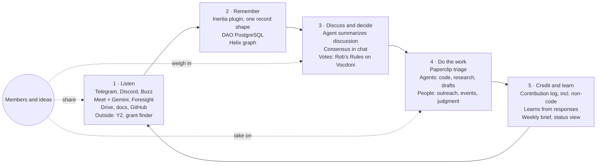

# Proposal: member-centered loop

Proposed 2026-10-24 against `develop` `a1fa90d` (PR53). Status: **proposal for discussion**. This file is not a canonical artifact and changes no existing contract, decision or sprint priority. The canonical-artifact owner decides what, if anything, is adopted into spec, plan, decisions, testing and the deck.

## Summary

Inertia already connects DAO conversations, meetings, grant packets and member agents, with Paperclip as the operational platform (D10) and Buzz and the dashboard as alternative interfaces (D11). This proposal adds a member-facing layer on top of that foundation:

- **Members and their ideas are the focus.** Agents do the backend work (code, research, drafting, summaries). Work that needs a person (creative input, judgment, relationships, outreach, events, real-world tasks) is routed to the right member as a prepared, specific ask.
- **Anyone can take part.** Members reach Inertia from the chat they already use (Telegram, Discord or Buzz) or a simple web view, identified by the email-based identity they already use for voting. No self-managed keys required.
- **Deliberation is real work.** Much DAO work (pursuing grants, outreach, partnerships) needs member discussion before anyone acts. Agents summarize discussions and turn rough consensus into clear proposals.
- **The agent stays inside boundaries the DAO sets**, with a layered governance model tied to the Constitution and ratified votes.

Nothing here asks to change the October 30 demo scope. The grant storyline below fits the existing three outcomes (D01).

## The loop

1. **Listen.** Internal sources (chats, Wednesday Meet recordings and Gemini notes, optional on-device Foresight notes exported to Drive, Drive documents, the GitHub repo) and external plugins (Y2, the grant finder, others as needed) enter through one adapter boundary and become one record shape with source, time and author.
2. **Remember.** Records land in DAO PostgreSQL under the existing [storage contract](../development/dao-data-consolidation.md); the existing outbox projects them to Helix, where internal and external knowledge connect (a company mentioned in a meeting is the same node as that company in a Y2 alert).
3. **Discuss and decide.** Agents post short briefs into chat, summarize discussion, surface agreement and open questions, and draft proposals. Formal decisions use the existing vote path; informal ones close by recorded consensus.
4. **Do the work.** Paperclip breaks work into tasks and asks of each: does this need a person? Agent work stays with agents. Human asks go to members who fit, with the research and drafting already attached.
5. **Credit and learn.** Every contribution earns credit, including introductions, events and discussion, not just completed engineering tasks. Responses to suggestions (accept, decline, ignore) are recorded so suggestions improve. Results feed back into Listen.

## What this builds on

| Existing work | Role in the loop |
|---|---|
| Signed Buzz bridge, confirmation cards, comment mirroring | Template for additional chat adapters; Buzz remains a first-class channel |
| Roundtable meeting source/native composition (PR34) | Meeting input for Listen |
| DAO PostgreSQL storage contract, partner graph, outbox to Helix (Task 6, 6A–6D) | Remember; relationship context for matching and outreach |
| Discovery foundation and source-bound funding facts (PR35/36) | Grant finder as the first external plugin |
| Grant packet binding and Vocdoni verifier path (PR7, U06, NTF08) | Decide; unchanged |
| Member candidate boundary (PR37), member ingress (#41) | Basis for member identity and contribution receipts |
| Paperclip tasks, checkout, approvals, budgets (D10, D12) | Do the work; enforcement for the governance layers below |

## Proposed additions

Each slice is default-disabled, fixture-first and follows [SPRINT-COORDINATION](../SPRINT-COORDINATION.md). Implementation issues would be opened only when the owner agrees and the input contract is ready.

| ID | Slice | Notes and dependencies |
|---|---|---|
| M1 | **Identity sync** from the Rob's Rules member list (email-based ID) with opt-in, verified chat links | Verification by one-time code or bot link, never by typed handle. Consent recorded per platform. Internal member ID with email as a linked attribute. Existing Nostr key pairing for Buzz stays as the signing authority. Needs a member-list export or route from the Rob's Rules owner (new team input). Identity sync only: no change to proposal or vote flows. |
| M2 | **Telegram and Discord adapters** into the same native comments and tasks as the Buzz bridge | Reuse bridge patterns: verified author, idempotent ingest, recoverable receipts. Inertia bot responds only to linked members or explicit commands. |
| M3 | **Inertia schema** in DAO PostgreSQL | Isolated schema and role per the storage contract: opt-in message log with retention rule, identity links and consent, member profile (skills, interests, availability, social links), contribution and credit log, suggestion log. Changes flow to Helix through the existing outbox. |
| M4 | **Discussion synthesis** | Thread and meeting summaries; agreement and open questions; draft proposals with sources. Output is a native document or comment; no new decision path. |
| M5 | **Human-ask routing** | Triage per task: agent or person. Matching on profile, contribution history, relationships and current load. Prepared asks with context and a definition of done. Per-member weekly notification cap. Each suggestion states why it was made. |
| M6 | **Credit for non-code work** | Introductions, events, review and discussion recorded as contributions with source evidence. Credit assignment above a threshold requires a named reviewer's approval. |
| M7 | **Member status view** | Simple web view for any verified member: initiative status, vote status, open asks and own contributions, through the Paperclip API and vote readback. Not a fork or embed of the Paperclip UI. |
| M8 | **Layered agent governance** | See below. Mostly configuration, documentation and approval policy on existing Paperclip facilities. |

## Layered governance for agents

Agent behavior comes from **rules** (what it may do, what needs a person, priorities, what it may read) and **context** (what it knows). Context informs judgment within the rules and never changes them.

1. **Constitution.** Outer boundary. Changes need a full vote and codification. Agents may draft amendments only.
2. **Ratified rules.** Versioned policies adopted by vote; each rule cites its source vote. A vote binds an exact rule-set version, mirroring how a vote binds an exact grant packet.
3. **Bounded member adjustments.** Verified members may tune parameters inside vote-set ranges (for example, notification caps or hotlist topics). Adjustments are logged, attributable and reversible; contested adjustments escalate to a vote.
4. **Personal preferences.** Each member controls how agents treat them.

Stewards can pause an agent, reverse an action or disable an integration immediately. Agents check that consequential actions are within current rules before acting and ask or draft a proposal when they are not. External and chat content is treated as data, never as instructions. Agent-written code and anything sent in the DAO's name require human approval.

## Example: a grant, end to end

1. The grant finder surfaces an opportunity matching an active initiative discussed at a Wednesday meeting.
2. Agents pull related initiative history, past funder contact from the partner graph, eligibility facts and gaps.
3. Agents post a short brief in chat; members discuss; agents summarize into a go or no-go.
4. Paperclip splits the application: agents draft narrative and budget tables; members receive prepared asks (a letter of support from a known contact, choosing the lead community story, reviewing numbers).
5. The frozen packet goes to a vote bound to that exact version (existing path).
6. A designated member submits; submission stays a separately authorized human action.
7. Contributors receive credit, including non-code asks; the outcome returns to memory for the next opportunity.

For the demo, steps 4 and 7 could show one or two members answering a prepared ask in chat. Submission can be shown as the handoff rather than performed.

## Open questions for the owner

1. Which, if any, of M1–M8 fit before October 30, and which follow?
2. Is the Rob's Rules member list the right identity source for non-Buzz channels, alongside existing key pairing?
3. Should the Inertia schema live in DAO PostgreSQL or start in plugin storage until NTF04 is settled?
4. Who owns the agent governance charter and its first ratification vote?
5. Which success measures to track: tasks claimed and finished between meetings, first contributions by new members, agent-versus-human task split, suggestion decline rate.

## Boundaries

This proposal contains no credentials, private member or meeting records, or runtime captures. It authorizes no deployment, enrollment, live data transfer, external messages, votes or submissions.
